<h1 align="center">Koi Aquarium</h1>

<p align="center"><b>A pixel-art aquarium for your GitHub profile. Your koi grows as you build.</b></p>

<p align="center">
  
  
  
</p>

<p align="center">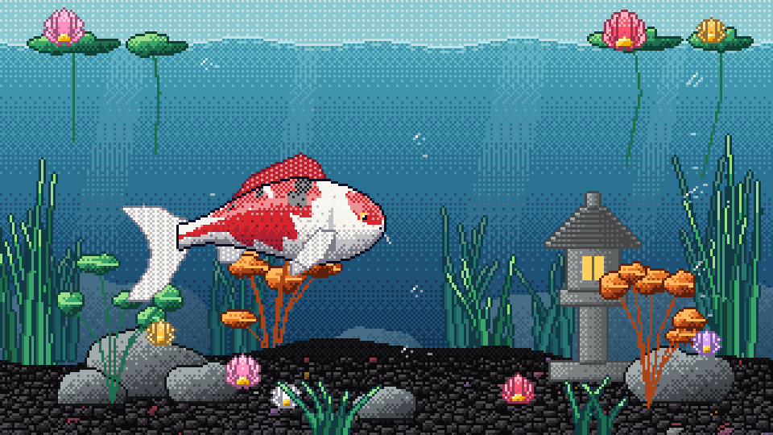</p>

## What it does

- Draws a koi swimming around plants, rocks and gravel, all in one pixel style.
- Grows the koi from your contributions and speeds it up after an active day.
- Redraws every night with a GitHub Action. No server and no keys.
- Lets you change the theme, colours, scenery, creatures and size.

## How it works

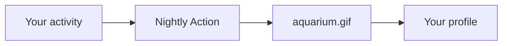

## What you need

| You need | Notes |
|---|---|
| A GitHub account | A personal account, not an organisation |
| A profile repository | Public, named exactly like your username |
| 5 minutes | Everything can be done in the browser |

## Set it up

<p align="center"></p>

### Step 1. Make your profile repository

Create a **public** repository named exactly like your username, with a README. Skip this if you have one.

### Step 2. Add the workflow

In that repository choose **Add file**, then **Create new file**. Name it
`.github/workflows/aquarium.yml` and paste in [`examples/aquarium.yml`](examples/aquarium.yml). Commit it.

### Step 3. Show the picture

Add this line to the repository's `README.md`:

```html

```

### Step 4. Run it once

Open the **Actions** tab, choose **Aquarium**, then **Run workflow**. After a minute your koi appears.

## Make it yours

Add settings under `with:` in your workflow:

```yaml
- uses: c7xto/Koi-Aquarium@v1
  with:
    theme: night
    name: Mochi
    colors: gold
    creatures: auto
    streak-rewards: true
    sign: true
```

<p align="center">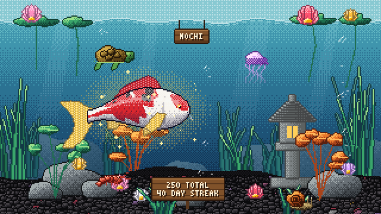</p>

### Themes

<table>
<tr><td align="center">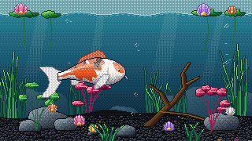<br><code>planted</code></td><td align="center"><br><code>japanese</code></td><td align="center">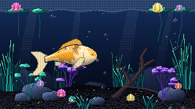<br><code>night</code></td></tr>
<tr><td align="center">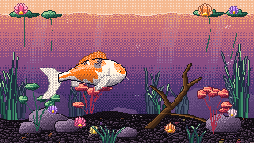<br><code>sunset</code></td><td align="center">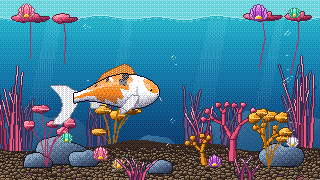<br><code>reef</code></td><td align="center">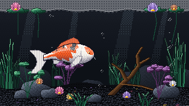<br><code>dark</code></td></tr>
</table>

### All settings

| Setting | Default | What it does |
|---|---|---|
| `theme` | `japanese` | japanese, planted, night, sunset, reef or dark |
| `dark-theme` | empty | Also draw this theme for dark-mode visitors (aquarium-dark.gif) |
| `size` | `wide` | wide, banner or square |
| `colors` | empty | kohaku, orange, gold, black, blue, platinum, sakura, languages, or #rrggbb,#rrggbb,#rrggbb |
| `name` | empty | Name tag for your koi, up to 16 letters or numbers |
| `hide` | empty | Any of decor, rocks, plants, flowers, bubbles |
| `milestones` | `500,2000` | Contributions at which another koi joins |
| `max-fish` | `3` | Most koi in the tank, 1 to 5 |
| `creatures` | `none` | none, auto, all, or any of snail, shrimp, turtle, jellyfish |
| `evolution` | `false` | true: fry, young, adult, elder, dragon |
| `streak-rewards` | `false` | true: sparkles, golden fins and a glow for streaks |
| `sign` | `false` | true: a sign with your total and streak |
| `speed` | `0` | Milliseconds per frame, 40 to 400. 0 follows your activity |
| `login` | `repository owner` | Whose activity to draw (users only) |
| `output` | `aquarium.gif` | Where to write the GIF |

If you change `output`, change the commit step and the image link to match.

### Light and dark versions

Set `dark-theme: night` and use this in your README instead of the single image:

```html
<picture>
  <source media="(prefers-color-scheme: dark)" srcset="aquarium-dark.gif">
  
</picture>
```

### Banner size

`size: banner` draws a shorter, wider tank.

<p align="center">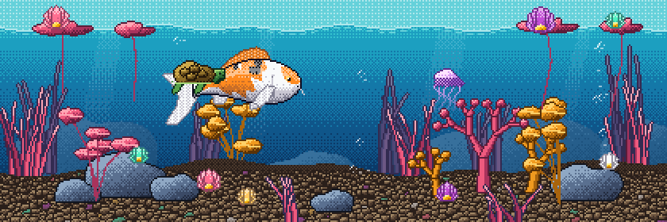</p>

## How your koi grows

| Your activity | In the aquarium |
|---|---|
| All-time contributions | The koi grows, fast at first and then slowly |
| At least one contribution yesterday | It swims faster |
| A quiet day | It drifts slowly |
| 500 and 2,000 contributions (`milestones`) | Another koi joins |

### Evolution (`evolution: true`)

| Contributions | Stage |
|---|---|
| 0 | Fry |
| 50 | Young |
| 250 | Adult |
| 1,000 | Elder: long fins and whiskers |
| 5,000 | Dragon koi: golden fins and horns |

<p align="center">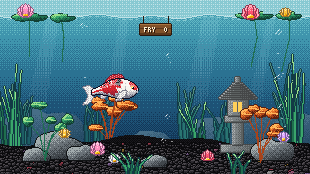</p>

### Streak rewards (`streak-rewards: true`)

| Days in a row | Reward |
|---|---|
| 3 | Sparkles |
| 7 | Golden fins |
| 30 | A glow around your koi |

### Creatures (`creatures: auto`)

| Contributions | Joins your tank |
|---|---|
| 100 | Snail |
| 250 | Shrimp |
| 750 | Turtle |
| 1,500 | Jellyfish |

## Try it on your computer

```bash
git clone https://github.com/c7xto/Koi-Aquarium.git
cd Koi-Aquarium
pip install pillow
python aquarium.py --theme reef --total 1200 --streak 9 --creatures all --out preview.gif
```

Open `preview.gif`. Run `python aquarium.py --help` for every option.

## Good to know

- The picture changes **once a night**. Visitors cannot click or play with it.
- Days are counted in UTC.
- Private contributions count only if you show them on your profile.
- `colors: languages` uses the languages of your **public** repositories.
- The action runs with your repository's built-in token, limited by the workflow's permissions.

## If something goes wrong

| Problem | What to do |
|---|---|
| No picture on the profile | Run the workflow once, and check the repository is public and named like your username |
| `Permission denied` when it saves | **Settings > Actions > General > Workflow permissions**, choose **Read and write** |
| It stopped updating | GitHub pauses schedules in quiet repositories after 60 days. Re-enable it in **Actions** |
| `unknown value` error | Check the spelling against the settings table |

## For developers

```bash
python -m unittest discover -s tests
```

| File | What is in it |
|---|---|
| `scene.py` | Themes, scenery and the koi |
| `extras.py` | Creatures, name tag, sign and streak effects |
| `aquarium.py` | Activity, settings and the command line |

## Licence

[MIT](LICENSE)
